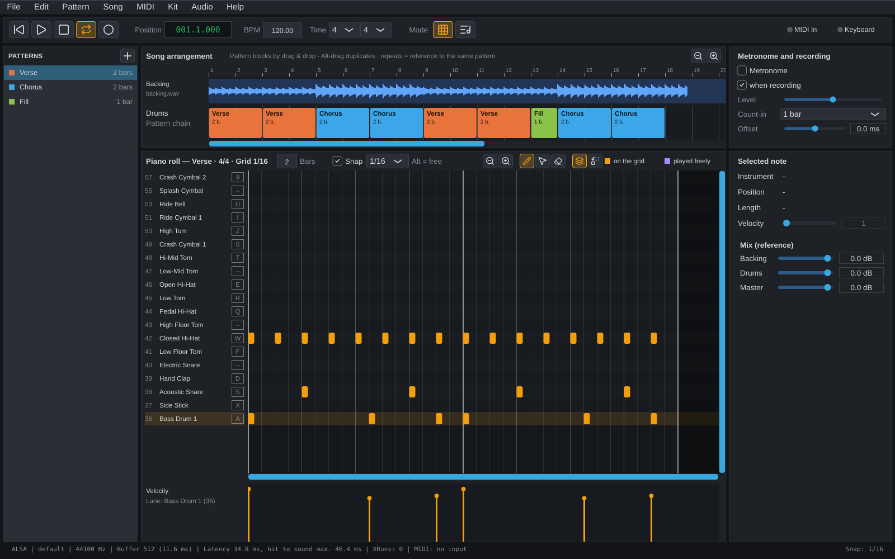

# Drum Programmer

Drum Programmer is a desktop application for programming drum patterns. You play beats in live on your computer keyboard or a MIDI controller, edit them in a piano roll, arrange them into a song, play along with a backing track and export the result as a MIDI file. It is built with JUCE/C++ and runs on Linux (ALSA/JACK) and Windows (ASIO/WASAPI).



## Features

- **Live input:** play drums on the computer keyboard or on MIDI hardware with low latency (target: 5 ms round trip with a suitable audio interface). Keys are mapped by physical position, so the layout is the same on QWERTY and QWERTZ keyboards, and can be changed freely.
- **Recording:** Rec + Play records your hits with velocity into the active pattern in a loop, with metronome, count-in and latency compensation. Overdub and replace modes; every pass is one undo step.
- **Piano roll:** add, move and delete notes with the mouse, edit velocity, snap to grid (1/4 to 1/32 and triplets) or place notes freely. Pattern length and time signature are adjustable.
- **Song arrangement:** place patterns as blocks on a song timeline. Repeated blocks refer to the same pattern, so editing it once updates every occurrence.
- **Backing track:** import a WAV file, see its waveform above the drum track and play along in sync. Each recording pass in song mode becomes a new pattern "Take n" on the drum track. Backing track and drums each have their own volume.
- **MIDI import and export:** import a Standard MIDI File as a new pattern, export a single pattern or the whole song as a MIDI file for use in any DAW.
- **Kits:** samples are assigned to slots following the General MIDI drum map (notes 35 to 59), each slot with its own pitch control. The kit is a program-wide setting; a project can carry its own kit if needed.
- **Projects:** save and load projects as `.dpp` files with undo/redo for all edits. Samples and the backing track are referenced relative to the project file, so projects stay portable. Unsaved changes are backed up every five minutes and offered for restoring after a crash.
- **Interface:** dark and light color scheme, English and German user interface.

## Download

The [releases](https://github.com/ladych/DrumProgrammer/releases) provide:

- **Linux:** `DrumProgrammer-<version>-x86_64.AppImage`. Make it executable (`chmod +x`) and start it; a project file can be passed as an argument. It runs on distributions with glibc 2.35 or newer (e.g. Ubuntu 22.04, Linux Mint 21) and uses ALSA, or JACK if it is installed.
- **Windows:** `DrumProgrammer-<version>-Setup.exe`, an installer for 64-bit Windows 10 and 11. It can associate `.dpp` files with the program. ASIO drivers are used if installed, otherwise WASAPI.

How a release is made and checked is described in [docs/Release-Test.md](docs/Release-Test.md).

## Building

Requirements: CMake ≥ 3.22, Ninja and a C++20 compiler (GCC/Clang on Linux, Visual Studio (MSVC) on Windows). On Linux you also need the JUCE dependencies:

```sh
sudo apt install libasound2-dev libjack-jackd2-dev libfreetype-dev libfontconfig1-dev \
  libx11-dev libxcomposite-dev libxcursor-dev libxext-dev libxinerama-dev \
  libxrandr-dev libxrender-dev libgl1-mesa-dev
```

JUCE and GoogleTest are Git submodules under `external/`:

```sh
git clone --recurse-submodules https://github.com/ladych/DrumProgrammer.git
# for an existing clone: git submodule update --init --recursive
cmake --preset debug
cmake --build --preset debug
ctest --preset debug
```

**Windows with ASIO:** since October 2025 Steinberg provides the ASIO SDK under GPLv3, which is compatible with the AGPLv3 of this project. CMake downloads the pinned version (2.3.4, verified by SHA-256) from Steinberg while configuring; it is not part of the repository. Without internet access, unpack the SDK yourself and pass `-DDRUMPROG_ASIO_SDK_DIR=C:/path/to/asiosdk` (the directory containing `common/iasiodrv.h`); `-DDRUMPROG_ASIO=OFF` builds without ASIO. The CI provides the finished Windows program as the artifact `DrumProgrammer-Windows`.

On first start the program uses ASIO if an ASIO driver is installed, otherwise WASAPI (ALSA on Linux). If the selected device fails (for example, the interface is unplugged), playback continues on the next driver and switches back as soon as the device returns; the status bar shows this.

CLion reads `CMakePresets.json` directly.

## Default kit

On first start the program plays the default kit: the GM slots 35 to 59 with samples from the kit "Black Pearl" of the [AVL Drumkits](http://www.bandshed.net/avldrumkits/) by Glen MacArthur, using the highest velocity layer of each instrument. The samples live in `resources/DefaultKit/`, are built into the program and copied to the settings folder on start (`DefaultKit/` next to `kit.xml`). **Kit → Reset to default** restores the kit, **Kit → Edit kit...** (Ctrl+K) opens the kit dialog.

## Languages

The user interface is available in English and German; **Help → Language** selects it. The default is the operating system's language, otherwise English. The choice takes effect on the next start and is stored as `language.txt` in the settings folder.

In the code all texts are written in English inside `i18n::tr("...")` (or `i18n::marked("...")` in tables). Each additional language is a file `resources/Languages/<ISO-639-1 code>.txt` in the format of `juce::LocalisedStrings` that is built into the program; the header of [resources/Languages/de.txt](resources/Languages/de.txt) explains how to add a new language. Missing translations fall back to the English text. `tools/check-translations.py` (also run as the test `TranslationsComplete`) checks that every file contains every text.

## Made with Claude

This program was created with [Claude](https://claude.ai) by Anthropic: requirements, design, code, tests and documentation were developed together with Claude Code.

## License

GNU Affero General Public License v3.0, see [LICENSE](LICENSE). The license follows from the open source license of JUCE.

The samples of the default kit are licensed under [CC BY-SA 3.0](https://creativecommons.org/licenses/by-sa/3.0/) (AVL Drumkits, Glen MacArthur), see [resources/DefaultKit/LIESMICH.txt](resources/DefaultKit/LIESMICH.txt). The button icons come from [Lucide Icons](https://lucide.dev) (ISC License, some icons from Feather under MIT License), see [resources/Icons/LIESMICH.txt](resources/Icons/LIESMICH.txt). The program lists all third-party components and their licenses under **Help → About and licenses...**.
